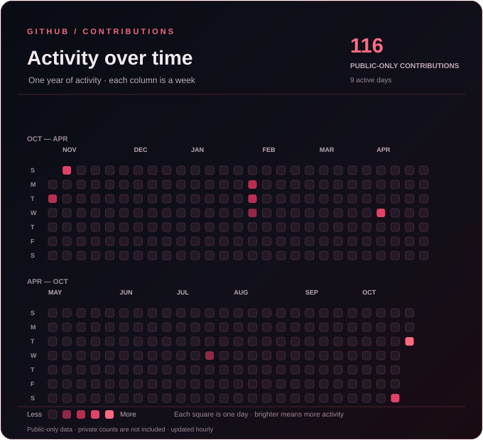

 

# Fawzan Khan

**Building useful software at the intersection of AI, automation, and the web.**

I develop integrations and tools that make complex systems easier to use. My work focuses on practical workflows, reliable APIs, and open-source projects.

[Classroom Desk](https://github.com/Fawzankhan-404/Classroom-Desk) · [Portfolio](https://fawzankhan-404.github.io/) · [Repositories](https://github.com/Fawzankhan-404?tab=repositories)

---

### Selected work

**[Classroom Desk](https://github.com/Fawzankhan-404/Classroom-Desk)**  
An open-source integration connecting Google Classroom with ChatGPT through the Model Context Protocol (MCP). Built to help people access classroom information through natural-language workflows.

**[Edu-Insight](https://github.com/Fawzankhan-404/Edu-Insight)**  
An education-focused project. See the repository for its current features and implementation.

**[Data_set_maker](https://github.com/Fawzankhan-404/Data_set_maker)**  
A public project in my GitHub portfolio.

### Tools & technologies

`TypeScript` · `JavaScript` · `Python` · `Cloudflare` · `MCP` · `Google APIs`

### Contributions in 3D

The 3D contribution graphic is generated by GitHub Actions from my actual activity.

---

Build quietly. Ship thoughtfully.

