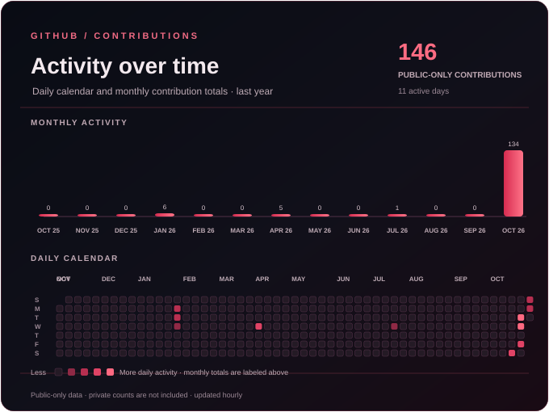
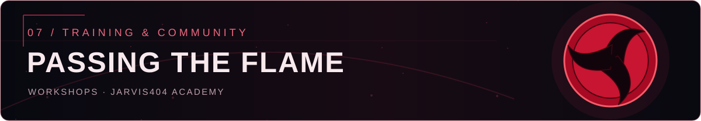

<picture><source srcset="./visuals/ui-crimson-intro.gif" type="image/gif" /></picture>

**AI & Software Developer · Open Source · Automation**

*Building useful AI-powered applications, privacy-minded software and practical digital tools from Pune, India.*

[**PORTFOLIO**](https://fawzankhan-404.github.io/) · [**CLASSROOM DESK**](https://github.com/Fawzankhan-404/Classroom-Desk) · [**PROJECTS**](https://fawzankhan-404.github.io/#projects) · [**CONTACT**](mailto:jarvis404.dev@gmail.com)

---

### About Me

I'm a software developer at **Elites Pro Academy** and a **B.Sc. Computer Science student at Poona College, Pune (2024–2027)**. I build AI assistants, integration tools, privacy-focused communication products, learning experiences and everyday automation, with an interest in making technology genuinely useful.

<picture><source srcset="./visuals/ui-missions.gif" type="image/gif" /></picture>

### Featured software

- **[Classroom Desk](https://github.com/Fawzankhan-404/Classroom-Desk)** OPEN SOURCE · EDUCATION · MCP Google Classroom × ChatGPT integration for working with classroom information.
- **[Jarvis404](https://fawzankhan-404.github.io/#projects)** PERSONAL AI · AUTOMATION Personal assistant exploring natural computer interaction and useful automation.
- **[ConnectPeace](https://fawzankhan-404.github.io/#projects)** PRIVACY · COMMUNICATION Privacy-focused communication designed for more discreet digital connection.
- **[Sarah AI](https://fawzankhan-404.github.io/#projects)** CONVERSATIONAL AI · VOICE Conversational assistant exploring natural voice interaction.
- **[JUST SPEAK](https://fawzankhan-404.github.io/#projects)** LEARNING · SPEECH AI-supported English-speaking practice through natural conversation.
- **[Edu-Insight](https://github.com/Fawzankhan-404/Edu-Insight)** EDUCATION Education-focused software project.
- **[Data_set_maker](https://github.com/Fawzankhan-404/Data_set_maker)** DATA · DEVELOPER TOOLS Dataset-development and tooling project.

<b>Explore more projects and earlier experiments</b>

 

**Learning & productivity**

- **AI Token Cost Planner** — estimate AI model costs before building or scaling.
- **[Jarvis404 Academy](https://courses.jarvis404.com/)** — hands-on AI, coding and automation learning.
- **Track404** — daily productivity, task timing and fitness routines.
- **Schedule Tracker** — tasks, priorities and daily reminders.

**Conversational AI**

- **Jarvis4H** — emotion-aware conversational AI experiment.
- **Relationship Assistant** — personal reminders, preferences, shared dates and memories.
- **Karen** — friendly everyday AI companion.
- **Innovate4H** — supportive conversation and self-reflection experiment.

**Automation & experiments**

- **Cryptocurrency Trading Bot** — automated trading and market-monitoring experiment.

[Explore all projects and screenshots →](https://fawzankhan-404.github.io/#projects)

<picture><source srcset="./visuals/ui-arsenal.gif" type="image/gif" /></picture>

  &nbsp;&nbsp;
  &nbsp;&nbsp;
  &nbsp;&nbsp;
  &nbsp;&nbsp;
  &nbsp;&nbsp;
  &nbsp;&nbsp;
  &nbsp;&nbsp;
  &nbsp;&nbsp;
  &nbsp;&nbsp;
  &nbsp;&nbsp;
  &nbsp;&nbsp;
  

TECHNOLOGIES · LOCALLY HOSTED ICONS · SELECT A LOGO TO LEARN MORE

**Programming** · Python, JavaScript, C 
**Frontend** · HTML5, CSS3, React 
**Backend & data** · Node.js, SQL, Firebase 
**AI & automation** · LLMs, NLP, voice interfaces, intelligent automation 
**Developer tools** · Git, GitHub, VS Code, Jupyter Notebook 
**Areas of interest** · Data visualization, structured analysis, machine learning workflows, secure coding, network security fundamentals 
**Spoken languages** · English (fluent), Roman Urdu (fluent)

<picture><source srcset="./visuals/ui-chronicle.gif" type="image/gif" /></picture>

**GitHub contribution activity · Updated hourly**

[**GitHub profile statistics →**](https://github.com/Fawzankhan-404)
[**Explore repository languages →**](https://github.com/Fawzankhan-404?tab=repositories)

Monthly totals are labeled on the chart; open the linked GitHub profile calendar for exact per-day counts. Public-only contribution data. An optional repository secret with GitHub’s `read:user` scope can include private and internal counts when enabled in profile settings. Updated hourly, subject to Actions and image caching. [View the live calendar](https://github.com/Fawzankhan-404).

<a href="https://github.com/Fawzankhan-404/Fawzankhan-404/blob/main/visuals/ui-journey.svg"><picture><source srcset="./visuals/ui-journey.gif" type="image/gif" /></picture></a>

### Experience

**Software Developer — Elites Pro Academy**  
Software development, applied AI and practical digital solutions.

**Software Developer Intern — Wee Technology**  
Software development internship.

### Education

**B.Sc. Computer Science — Poona College, Pune** · 2024–2027  
Relevant coursework: Data Structures, Algorithms, Web Development, Cybersecurity, Database Management.

<picture><source srcset="./visuals/ui-recognition.gif" type="image/gif" /></picture>

**Certifications:** Python for Data Science (Coursera); Web Security Fundamentals (freeCodeCamp); JavaScript Algorithms and Data Structures.

**Recognition:** IoT Course by IAO-USA Accredited Courses — **#1 rank**; Technovate for India — **Top 5**; Aavishkar 2024 zonal-level research competition — **#17 in Pure Science** and **#20 in Humanities**.

<picture><source srcset="./visuals/ui-models.gif" type="image/gif" /></picture>

The **Jarvis404 LLM family** explores more personal AI dialogue, emotional awareness and reflective interactions through local models.

- **Jarvis404-llm-v01-8b** CONNECTED DIALOGUE · [View on Ollama →](https://ollama.com/fawzan/Jarvis404-llm-v01-8b)
- **Jarvis404-Companion-LLM-v0.2** COMPANION & REFLECTION · [View on Ollama →](https://ollama.com/fawzan/Jarvis404-companion-llmv0.2)
- **Jarvis404-Companion_Q8-LLM-v0.2** LOCAL MODEL EXPERIMENT · [View on Ollama →](https://ollama.com/fawzan/Jarvis404-companion_Q8-llmv0.2)
- **Friday** UPCOMING · Next model experiment; details after release.

*The Ollama links open model pages, not in-browser chat demos.*

<picture><source srcset="./visuals/ui-training.gif" type="image/gif" /></picture>

### Jarvis404 Academy

I help students and beginners explore AI, programming, automation, and project building through practical training. Sessions and workshops can be adapted to colleges, institutes, and learners at different levels.

[**Explore Academy →**](https://courses.jarvis404.com/) · [**AI Developer Bootcamp →**](https://courses.jarvis404.com/courses/ai-developer-bootcamp) · [**Discuss a workshop →**](https://fawzankhan-404.github.io/#contact)

<picture><source srcset="./visuals/ui-contact.gif" type="image/gif" /></picture>

**Have an idea involving AI, software or learning?**

[**EMAIL**](mailto:jarvis404.dev@gmail.com) · [**GITHUB**](https://github.com/Fawzankhan-404) · [**INSTAGRAM**](https://www.instagram.com/fawzan._x1/) · [**PORTFOLIO**](https://fawzankhan-404.github.io/)

<picture><source srcset="./visuals/ui-end.gif" type="image/gif" /></picture>

© 2026 Fawzan Khan · Itachi Uchiha-inspired independent fan-art profile

